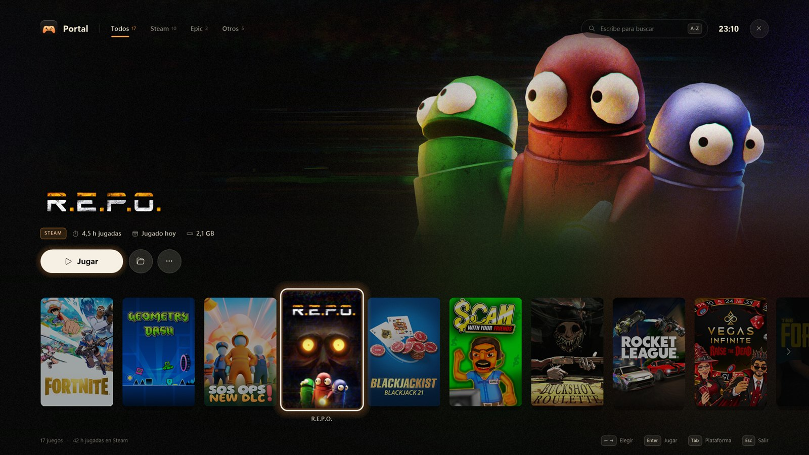
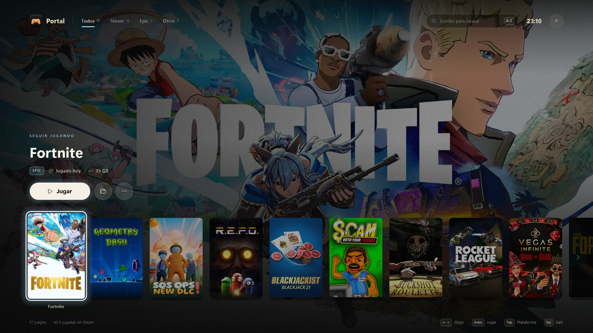
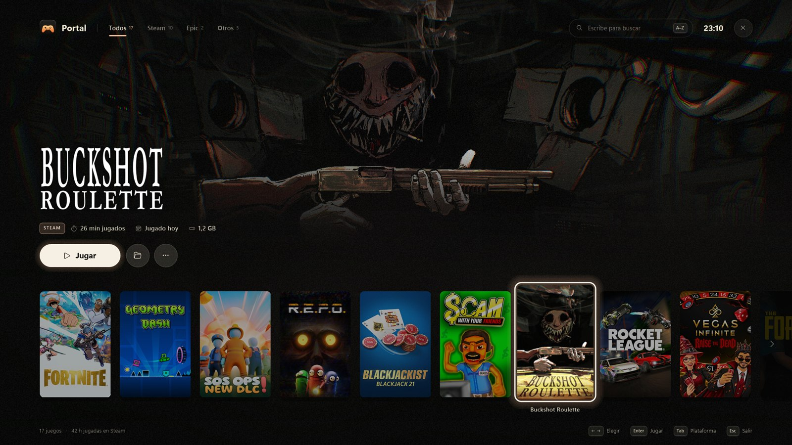
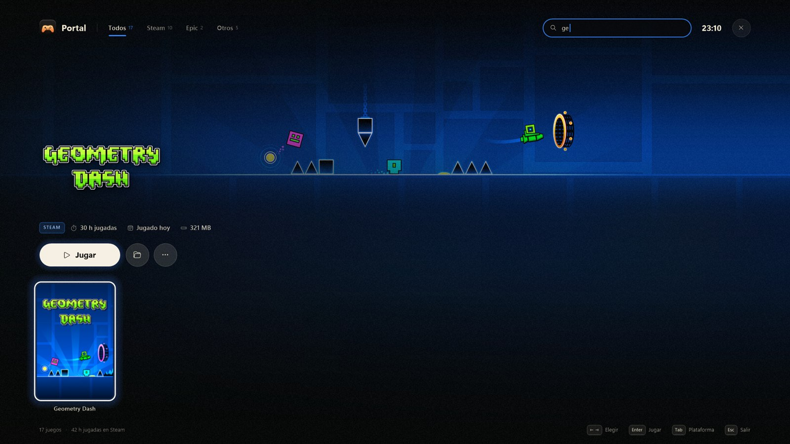
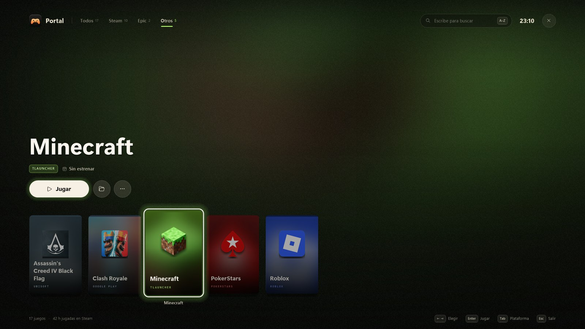

<p align="center">
  
</p>

<h1 align="center">Portal de juegos</h1>

<p align="center">
  Todos tus juegos de PC en una sola pantalla, con aspecto de menú de consola.<br>
  Nativo, sin instalar nada y sin gastar nada cuando está cerrado.
</p>

<p align="center">
  
  
  
  
</p>



---

## Qué es

Un lanzador de juegos a pantalla completa para Windows, hecho a mano con **C# puro y GDI+**. No usa Electron, ni WPF, ni librerías externas. Se compila con el `csc.exe` que ya trae Windows y el resultado es un `.exe` de unos 140 KB.

- Al abrirlo, **busca los juegos que tienes instalados**: Steam y Epic Games solos, y el resto desde un archivo de texto.
- **Se cierra solo** al lanzar un juego o al cambiar de ventana. Mientras está cerrado no ocupa memoria ni CPU, porque no queda nada en segundo plano.

## Lo que tiene

| | |
|---|---|
| 🎮 **Detecta tus juegos solo** | **Steam**: todas tus bibliotecas. **Epic Games**: sus manifiestos. El resto se añade en `juegos-extra.txt` con un `.exe`, un acceso directo o un enlace (`uplay://`…). |
| 🖼️ **Arte de verdad** | Carátulas, fondos y logos de la caché de Steam. De Epic, la carátula y el fondo oficiales, que se bajan una sola vez y se guardan reducidos. Para los demás, una carátula generada con su icono y sus colores. |
| 🌅 **Fondo vivo** | Detrás de todo, el arte del juego seleccionado, fundido con una "luz ambiente" sacada de la propia imagen. Al cambiar de juego hay un fundido suave, y el color de acento se adapta a cada juego. |
| ⏱️ **Tus datos** | Horas jugadas y última partida (Steam), tamaño en disco (Steam y Epic) y la etiqueta "Seguir jugando" en el último que abriste. |
| 🔎 **Escribe y ya** | No hay que hacer clic en el buscador: basta con empezar a escribir. Arriba hay filtros por plataforma: Todos / Steam / Epic / Otros. |
| ⌨️ **Teclado o ratón** | Se maneja entero con el teclado, como una consola, o con el ratón. |
| 🪶 **Ligero** | Unos 29 ms en preparar cada fondo, unos 14 ms por fotograma durante los fundidos y 0 bytes cuando está cerrado. |

<table>
  <tr>
    <td></td>
    <td></td>
  </tr>
  <tr>
    <td></td>
    <td></td>
  </tr>
</table>

## Empezar

**Requisitos:** Windows 10 u 11 de 64 bits. .NET Framework 4.8 ya viene con Windows 10 (desde la versión 1903) y con Windows 11.

```bat
git clone https://github.com/Alvaro-Rovira/game-portal.git
cd game-portal
compilar.cmd
Portal.exe
```

- `compilar.cmd` genera `Portal.exe` y, si no existe, `juegos-extra.txt` a partir del ejemplo.
- Lo ideal es anclar `Portal.exe` a la barra de tareas o al dock y abrirlo desde ahí.

## Controles

| Tecla / gesto | Qué hace |
|---|---|
| Escribir | Buscar (lo que empieza por el texto sale primero) |
| `←` `→` · `Inicio` `Fin` · `RePág` `AvPág` | Elegir juego |
| `Enter` / clic en una carátula | **Jugar** |
| `Tab` / `Mayús`+`Tab` | Cambiar de plataforma |
| `Esc` | Borrar la búsqueda, o cerrar |
| Pasar el ratón por una carátula | Seleccionarla (sin mover la fila) |
| Rueda del ratón | Desplazar la fila |
| Clic derecho / tecla menú / botón `…` | Jugar, abrir la carpeta, ocultar o añadir juegos a mano |

## Añadir juegos que no son de Steam ni de Epic

Edita `juegos-extra.txt`, o desde el portal: clic derecho → *Añadir juegos a mano*. Va un juego por línea:

```text
Nombre | Plataforma | qué lanzar | portada (opcional) | icono: exe o png (opcional) | fondo (opcional)

Roblox    | Roblox    | %APPDATA%\Microsoft\Windows\Start Menu\Programs\Roblox\Roblox Player.lnk
Minecraft | Minecraft | %APPDATA%\.minecraft\TLauncher.exe
AC IV     | Ubisoft   | uplay://launch/273/0 | | C:\...\AC4BFSP.exe
```

- Si un programa ya no existe, ese juego deja de salir solo.
- Los juegos que ocultes se guardan en `juegos-ocultos.txt`.

## Cómo funciona por dentro

```
src/
├─ Portal.cs    ventana, dibujo, animaciones, teclado y ratón
├─ Games.cs     busca juegos, lee horas/tamaños, baja el arte de Epic y lanza
├─ Brand.cs     el icono y el logo, dibujados con vectores
├─ Surface.cs   ventana con transparencia por píxel (DIB + UpdateLayeredWindow)
├─ Gfx.cs       tema, fuentes, desenfoque e iconos del shell
└─ Native.cs    llamadas a Win32
```

<details>
<summary><b>Detectar juegos</b></summary>

- **Steam**: lee `libraryfolders.vdf` para encontrar todas las bibliotecas, y luego cada `appmanifest_*.acf` (nombre, carpeta y `SizeOnDisk`).
  - Horas y última partida: `userdata\<cuenta>\config\localconfig.vdf` (`Playtime` en minutos y `LastPlayed`).
  - Arte: `appcache\librarycache\<appid>\` (`library_600x900.jpg`, `library_hero.jpg` y `logo.png`).
  - Herramientas como SteamVR o los redistribuibles no salen.
- **Epic Games**: los manifiestos `*.item` de `ProgramData\Epic\EpicGamesLauncher\Data\Manifests` (solo los de la categoría `games`).
  - El catálogo del propio launcher (`catcache.bin`, en base64 con JSON dentro) tiene los enlaces a la carátula vertical y al fondo oficiales.
  - Se bajan una vez al CDN de Epic, reducidas, a `cache\`.
- **Otros**: `juegos-extra.txt`. Si el icono del `.exe` es diminuto, se usa un mando dibujado en su lugar.
</details>

<details>
<summary><b>Lanzar sin perder la orden</b></summary>

- Los enlaces (`steam://`, `com.epicgames.launcher://`, `uplay://`…) y los accesos directos se pasan a `explorer.exe`. Los `.exe` se arrancan directamente en su carpeta con `CreateProcess`.
- **Por qué no se usa `ShellExecute` sin más**: con el launcher de Epic cerrado, `ShellExecute` devuelve "OK" al momento, pero Windows atiende el enlace un par de segundos después. Si el programa que lo pidió ya se ha cerrado, la orden se pierde. `explorer.exe` sigue vivo lo que haga falta.
- Además, se intenta lanzar con `CREATE_BREAKAWAY_FROM_JOB`. Así, aunque el portal se abra desde algo que corre dentro de un *job* (una tarea programada, por ejemplo), el juego no depende de él.
</details>

<details>
<summary><b>Gráficos rápidos sin GPU ni librerías</b></summary>

- **La ventana**: es una ventana *layered* con transparencia por píxel. Se dibuja con GDI+ sobre un DIB y se presenta con `UpdateLayeredWindow`.
- **El fondo de cada juego**:
  - El arte ancho (3:1) va arriba y su borde de abajo se funde con una versión de 64×36 píxeles de la misma imagen, difuminada y estirada: la luz ambiente.
  - El arte 16:9 va a pantalla completa y oscurecido.
  - Encima van unos velos (izquierda, abajo y arriba) y un grano sutil, calculados **una sola vez**: componer un fondo nuevo cuesta unos 29 ms.
- **El fundido entre fondos** mezcla los píxeles directamente en memoria (`unsafe`, dos canales por operación): unos 14 ms por fotograma a 1080p.
- **El color de acento** de cada juego sale de su arte, ponderando los píxeles saturados y luminosos.
- **El arte se prepara en un hilo aparte**, empezando por el juego seleccionado. Las animaciones solo corren mientras algo se mueve; si nada cambia, no se redibuja.
</details>

<details>
<summary><b>Utilidades para desarrollo</b></summary>

```bat
Portal.exe --captura salida.png [foco] [texto] [filtro]   :: dibuja el portal en un PNG sin abrir ventana
Portal.exe --lista juegos.txt                             :: lista los juegos detectados
Portal.exe --lanzar <numero|clave>                        :: lanza un juego como el boton Jugar
Portal.exe --medir                                        :: tiempos de dibujo (en hud.log)
Portal.exe --icono portal.ico [muestra.png]               :: regenera el icono
```
</details>

## Archivos que crea al usarse

| Archivo | Para qué |
|---|---|
| `juegos-extra.txt` | Tus juegos añadidos a mano |
| `juegos-ocultos.txt` | Los que ocultaste |
| `juegos-recientes.txt` | Lo que lanzaste desde el portal (orden y "Seguir jugando") |
| `cache\` | Carátulas y fondos de Epic ya descargados |
| `hud.log` | Solo errores |

Ninguno se sube al repositorio (ver `.gitignore`).

## Licencia

[MIT](LICENSE). Las carátulas, logos y fondos de las capturas son de sus respectivos juegos y estudios. El portal no incluye ninguno: los lee de las cachés de Steam y Epic de tu propio PC.
